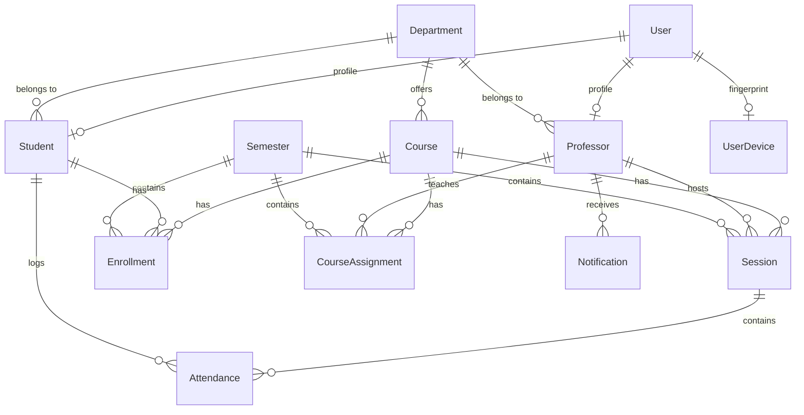

# Alarab Attendance System — Database Schema

This document outlines the core database schema for the Django backend. The system is divided into four main applications: `accounts`, `attendance`, `core`, and `courses`.

## 🗺️ Entity-Relationship Diagram

---

## 📦 `core` App (Foundational Models)

| Model | Field | Type | Description |
|-------|-------|------|-------------|
| **Department** | `id` | PK | Auto-increment ID |
| | `code` | Char (Unique) | e.g. "CS", "MATH" |
| | `name` | Char | Full department name |
| **Semester** | `id` | PK | Auto-increment ID |
| | `name` | Char | e.g. "Fall 2026" |
| | `start_date` | Date | |
| | `end_date` | Date | |
| | `is_active` | Boolean | Only one semester should be active at a time |
| | `total_lectures` | Integer | Quota for the semester |
| **Notification** | `id` | PK | Auto-increment ID |
| | `professor` | FK → Professor | Recipient |
| | `message` | Text | Alert content |
| | `notification_type` | Char | Choice field |
| | `is_read` | Boolean | Read status |

---

## 📚 `courses` App (Curriculum & Registration)

| Model | Field | Type | Description |
|-------|-------|------|-------------|
| **Course** | `id` | PK | Auto-increment ID |
| | `code` | Char (Unique) | e.g. "CS101" |
| | `name` | Char | e.g. "Intro to Programming" |
| | `department` | FK → Department | |
| **CourseAssignment** | `id` | PK | Auto-increment ID |
| | `course` | FK → Course | |
| | `professor` | FK → Professor | |
| | `semester` | FK → Semester | |
| | `expected_lectures`| Integer | Target lecture count for this specific assignment |

---

## 👥 `accounts` App (Users, Roles & Security)

*Note: The `User` model is Django's built-in authentication model (or a custom extension of it).*

| Model | Field | Type | Description |
|-------|-------|------|-------------|
| **Student** | `id` | PK | Auto-increment ID |
| | `user` | OneToOne → User | Auth linkage |
| | `student_id` | Char (Unique) | University ID number |
| | `name` | Char | Full name |
| | `department` | FK → Department | |
| | `student_major` | Char | Specific major |
| **Professor** | `id` | PK | Auto-increment ID |
| | `user` | OneToOne → User | Auth linkage |
| | `professor_id` | Char (Unique) | University ID number |
| | `name` | Char | Full name |
| | `department` | FK → Department | |
| **UserDevice** | `id` | PK | Auto-increment ID |
| | `user` | OneToOne → User | |
| | `device_fingerprint`| Char | Hardware/Browser hash to prevent proxying |
| | `linked_at` | DateTime | When the device was locked to the user |
| **Enrollment** | `id` | PK | Auto-increment ID |
| | `student` | FK → Student | |
| | `course` | FK → Course | |
| | `semester` | FK → Semester | |

---

## ⏱️ `attendance` App (QR Scanning & Sessions)

| Model | Field | Type | Description |
|-------|-------|------|-------------|
| **Session** | `id` | PK | Auto-increment ID |
| | `course` | FK → Course | The class being taught |
| | `professor` | FK → Professor | The teacher hosting |
| | `semester` | FK → Semester | |
| | `date_time` | DateTime | When the session started |
| | `qr_token` | Char (Unique) | JWT/UUID used for the check-in QR code |
| | `qr_expires_at` | DateTime | Hard expiration for the QR token |
| | `end_time` | DateTime (Nullable)| When the session ended (via QR scan or manual) |
| | `duration_minutes`| Float (Nullable) | Computed session length |
| | `teacher_note` | Text | Required if end_time is manually overridden |
| **Attendance** | `id` | PK | Auto-increment ID |
| | `session` | FK → Session | The specific lecture |
| | `student` | FK → Student | Who attended |
| | `course` | FK → Course | Denormalized for fast reporting |
| | `date` | Date | Extracted from session for indexing/reporting |
| | `scanned_at` | DateTime | Exact check-in time |
| | `status` | Char | Present/Late/Absent |

---

## 🔐 Key Constraints & Logic

1. **Device Fingerprinting (`UserDevice`)**: A `User` can only be linked to one `device_fingerprint` at a time. This enforces the "one student, one phone" rule to prevent proxy attendance scanning.
2. **Dynamic Session End Tracking (`Session.end_time`)**: Every time a student scans the "End Session" QR code, the backend overwrites `end_time` with `timezone.now()` and recalculates `duration_minutes`. The final duration is determined by the last student to scan out.
3. **Denormalization (`Attendance.course` & `Attendance.date`)**: Added to dramatically speed up Professor Attendance Reports which aggregate by course and date over the entire semester.
