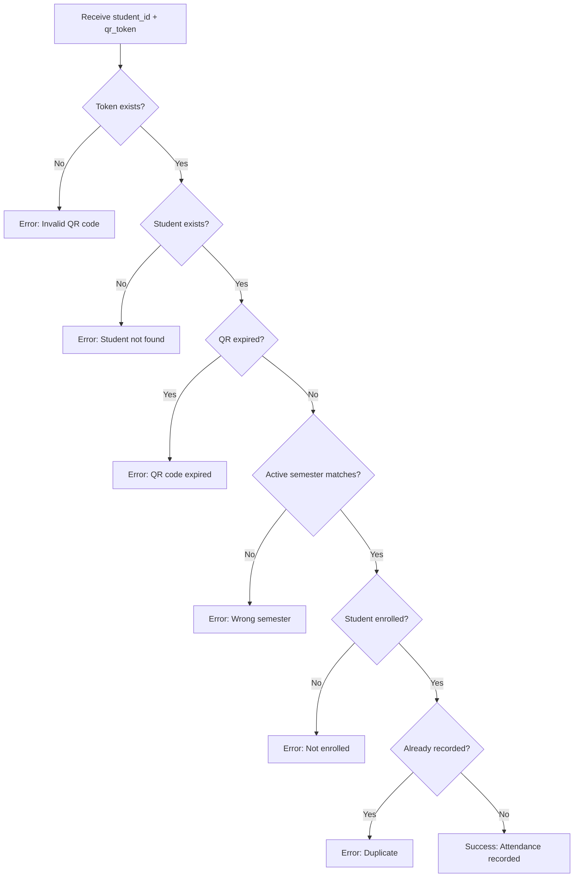

# QR Code System - Complete Documentation

## 📋 Table of Contents
1. [Overview](#overview)
2. [QR Code Flow](#qr-code-flow)
3. [Dependencies](#dependencies)
4. [Models](#models)
5. [QR Code Generation](#qr-code-generation)
6. [Serializers](#serializers)
7. [Views & API Endpoints](#views--api-endpoints)
8. [URL Configuration](#url-configuration)
9. [Business Logic (Services)](#business-logic-services)
10. [Admin Configuration](#admin-configuration)

---

## Overview

The QR code system in this project is used for **attendance tracking**. When a professor creates a class session, a unique QR code is generated. Students scan this QR code to mark their attendance for that session.

### Key Concepts:
- **QR Token**: A unique UUID4 string stored in the database
- **QR Image**: Visual representation of the token, generated on-demand as base64 PNG
- **Expiration**: QR codes expire 15 minutes after session creation
- **Validation**: Multiple checks ensure attendance is recorded only for valid, active sessions

---

## QR Code Flow

```
1. Professor creates a Session
   └─> qr_token auto-generated (UUID4)
   └─> qr_expires_at set to now() + 15 minutes

2. Professor requests QR code
   └─> GET /api/sessions/{session_id}/qr/
   └─> System generates QR image from qr_token
   └─> Returns base64-encoded PNG

3. Student scans QR code
   └─> POST /api/attendance/scan/
   └─> Sends: {student_id, qr_token}
   └─> System validates token and records attendance
```

---

## Dependencies

### File: `pyproject.toml` (line 14)
**Location:** `C:\Users\DQA\Ayoub Projects\Alarab_attends_system\backend\pyproject.toml`

```toml
"qrcode[pil]>=7.4",
```

### File: `requirements.txt` (line 150)
**Location:** `C:\Users\DQA\Ayoub Projects\Alarab_attends_system\backend\requirements.txt`

```
qrcode==8.2
```

**Package Details:**
- **Library**: `qrcode` version 8.2
- **Feature**: `[pil]` enables PIL (Pillow) support for image generation
- **Purpose**: Generates QR code images as PNG files

---

## Models

### Session Model
**File:** `attendance/models.py` (lines 32-61)  
**Location:** `C:\Users\DQA\Ayoub Projects\Alarab_attends_system\backend\attendance\models.py`

```python
class Session(models.Model):
    """A single class session with a QR code for attendance."""
    course = models.ForeignKey(Course, on_delete=models.CASCADE, related_name='sessions')
    professor = models.ForeignKey(Professor, on_delete=models.CASCADE, related_name='sessions')
    semester = models.ForeignKey(Semester, on_delete=models.CASCADE, related_name='sessions')
    date_time = models.DateTimeField(auto_now_add=True)
    qr_token = models.CharField(max_length=100, unique=True, db_index=True)
    qr_expires_at = models.DateTimeField()

    class Meta:
        ordering = ['-date_time']
        indexes = [
            models.Index(fields=['qr_token']),
            models.Index(fields=['course', 'semester']),
        ]

    def save(self, *args, **kwargs):
        if not self.qr_token:
            self.qr_token = str(uuid.uuid4())
        if not self.qr_expires_at:
            self.qr_expires_at = now() + timedelta(minutes=15)
        super().save(*args, **kwargs)
```

### Key Fields:

| Field | Type | Purpose |
|-------|------|---------|
| `qr_token` | CharField(100) | Unique identifier encoded in QR code. Auto-generated as UUID4 |
| `qr_expires_at` | DateTimeField | Expiration timestamp. Defaults to 15 minutes from creation |

### Auto-Generation Logic (in `save()` method):
1. If `qr_token` is empty → generate `str(uuid.uuid4())`
2. If `qr_expires_at` is empty → set to `now() + timedelta(minutes=15)`

### Database Indexes:
- Index on `qr_token` for fast lookups during scanning
- Composite index on `['course', 'semester']` for filtering

---

## QR Code Generation

### SessionQRView
**File:** `attendance/views.py` (lines 78-95)  
**Location:** `C:\Users\DQA\Ayoub Projects\Alarab_attends_system\backend\attendance\views.py`

```python
import base64
import io
import qrcode
from rest_framework.views import APIView
from rest_framework.response import Response
from rest_framework.status import HTTP_404_NOT_FOUND
from rest_framework.permissions import AllowAny

class SessionQRView(APIView):
    permission_classes = [AllowAny]

    def get(self, request, session_id):
        try:
            session = Session.objects.get(pk=session_id)
            
            # Step 1: Create QR code object
            qr = qrcode.QRCode(
                version=1,        # Controls size (1-40)
                box_size=10,      # Pixels per box
                border=5          # Border thickness
            )
            
            # Step 2: Add data (the qr_token)
            qr.add_data(session.qr_token)
            qr.make(fit=True)     # Optimize size
            
            # Step 3: Generate image
            img = qr.make_image(fill_color="black", back_color="white")
            
            # Step 4: Convert to base64
            buffer = io.BytesIO()
            img.save(buffer, format="PNG")
            img_b64 = base64.b64encode(buffer.getvalue()).decode()
            
            # Step 5: Return as data URI
            return Response({
                'qr_code': f"data:image/png;base64,{img_b64}"
            })
            
        except Session.DoesNotExist:
            return Response(
                {'error': 'Session not found'}, 
                status=HTTP_404_NOT_FOUND
            )
```

### Generation Process Explained:

| Step | Code | Description |
|------|------|-------------|
| 1 | `qrcode.QRCode(...)` | Creates QR code instance with configuration |
| 2 | `qr.add_data(session.qr_token)` | Sets the data to encode (the UUID token) |
| 3 | `qr.make(fit=True)` | Generates the QR matrix, optimizing size |
| 4 | `qr.make_image(...)` | Creates PIL image with black/white colors |
| 5 | `img.save(buffer, format="PNG")` | Saves image to memory buffer |
| 6 | `base64.b64encode(...)` | Encodes binary data to base64 string |
| 7 | Return `data:image/png;base64,...` | Returns web-ready data URI |

### QR Code Configuration:

| Parameter | Value | Effect |
|-----------|-------|--------|
| `version` | 1 | Smallest size (21x21 modules), sufficient for UUID |
| `box_size` | 10 | 10 pixels per module |
| `border` | 5 | Standard quiet zone border |
| `fill_color` | "black" | QR pattern color |
| `back_color` | "white" | Background color |

---

## Serializers

### SessionSerializer
**File:** `attendance/serializers.py` (lines 17-23)  
**Location:** `C:\Users\DQA\Ayoub Projects\Alarab_attends_system\backend\attendance\serializers.py`

```python
class SessionSerializer(serializers.ModelSerializer):
    course_code = serializers.CharField(source='course.code', read_only=True)
    professor_name = serializers.CharField(source='professor.name', read_only=True)

    class Meta:
        model = Session
        fields = [
            'id', 
            'course', 
            'course_code', 
            'professor', 
            'professor_name',
            'semester', 
            'date_time', 
            'qr_token',         # QR token exposed in API
            'qr_expires_at'     # Expiration time exposed in API
        ]
```

### Purpose:
- Serializes `Session` model for API responses
- Includes `qr_token` so clients can access the raw token
- Includes `qr_expires_at` so clients can check expiration
- Read-only computed fields: `course_code`, `professor_name`

### Example Output:
```json
{
    "id": 1,
    "course": 5,
    "course_code": "CS101",
    "professor": 2,
    "professor_name": "Dr. Smith",
    "semester": 3,
    "date_time": "2025-10-22T09:00:00Z",
    "qr_token": "a1b2c3d4-e5f6-7890-abcd-ef1234567890",
    "qr_expires_at": "2025-10-22T09:15:00Z"
}
```

---

## Views & API Endpoints

### 1. SessionQRView - Generate QR Code Image
**File:** `attendance/views.py` (lines 78-95)  
**Location:** `C:\Users\DQA\Ayoub Projects\Alarab_attends_system\backend\attendance\views.py`

```python
class SessionQRView(APIView):
    permission_classes = [AllowAny]

    def get(self, request, session_id):
        try:
            session = Session.objects.get(pk=session_id)
            qr = qrcode.QRCode(version=1, box_size=10, border=5)
            qr.add_data(session.qr_token)
            qr.make(fit=True)
            img = qr.make_image(fill_color="black", back_color="white")

            buffer = io.BytesIO()
            img.save(buffer, format="PNG")
            img_b64 = base64.b64encode(buffer.getvalue()).decode()

            return Response({'qr_code': f"data:image/png;base64,{img_b64}"})
        except Session.DoesNotExist:
            return Response({'error': 'Session not found'}, status=status.HTTP_404_NOT_FOUND)
```

**Endpoint Details:**

| Property | Value |
|----------|-------|
| **URL** | `GET /api/sessions/{session_id}/qr/` |
| **Permission** | `AllowAny` (no authentication required) |
| **Purpose** | Generate and return QR code image for a session |
| **Response** | `{"qr_code": "data:image/png;base64,..."}` |

**Flow:**
1. Receive `session_id` in URL
2. Fetch `Session` from database
3. Generate QR image from `session.qr_token`
4. Convert to base64 PNG
5. Return data URI

---

### 2. AttendanceScanView - Process Scanned QR Code
**File:** `attendance/views.py` (lines 98-113)  
**Location:** `C:\Users\DQA\Ayoub Projects\Alarab_attends_system\backend\attendance\views.py`

```python
class AttendanceScanView(APIView):
    permission_classes = [AllowAny]

    def post(self, request):
        student_id = request.data.get('student_id')
        qr_token = request.data.get('qr_token')

        if not student_id or not qr_token:
            return Response(
                {'error': 'student_id and qr_token are required'},
                status=status.HTTP_400_BAD_REQUEST
            )

        result = record_attendance(student_id, qr_token)

        if result['success']:
            return Response(result, status=status.HTTP_200_OK)
        else:
            return Response(result, status=status.HTTP_400_BAD_REQUEST)
```

**Endpoint Details:**

| Property | Value |
|----------|-------|
| **URL** | `POST /api/attendance/scan/` |
| **Permission** | `AllowAny` (no authentication required) |
| **Purpose** | Process scanned QR code and record attendance |
| **Request Body** | `{"student_id": "...", "qr_token": "..."}` |

**Request Parameters:**

| Parameter | Type | Required | Description |
|-----------|------|----------|-------------|
| `student_id` | string | Yes | Student's unique identifier |
| `qr_token` | string | Yes | Token decoded from scanned QR code |

**Response Examples:**

**Success (200 OK):**
```json
{
    "success": true,
    "message": "Attendance recorded for John Doe.",
    "attendance_id": 42
}
```

**Failure (400 Bad Request):**
```json
{
    "success": false,
    "error": "This QR code has expired."
}
```

---

## URL Configuration

### Attendance URLs
**File:** `attendance/urls.py`  
**Location:** `C:\Users\DQA\Ayoub Projects\Alarab_attends_system\backend\attendance\urls.py`

```python
from django.urls import path
from .views import SessionQRView, AttendanceScanView

urlpatterns = [
    # QR code image generation
    path(
        'sessions/<int:session_id>/qr/', 
        SessionQRView.as_view(), 
        name='session-qr'
    ),
    
    # QR code scanning endpoint
    path(
        'attendance/scan/', 
        AttendanceScanView.as_view(), 
        name='attendance-scan'
    ),
    
    # ... other attendance URLs
]
```

### Root URL Configuration
**File:** `config/urls.py`  
**Location:** `C:\Users\DQA\Ayoub Projects\Alarab_attends_system\backend\config\urls.py`

```python
from django.urls import path, include

urlpatterns = [
    path('api/', include('attendance.urls')),
    # ... other app URLs
]
```

### Complete URL Map:

| Full URL | View | Method | Purpose |
|----------|------|--------|---------|
| `/api/sessions/{id}/qr/` | `SessionQRView` | GET | Get QR code image |
| `/api/attendance/scan/` | `AttendanceScanView` | POST | Submit scan & record attendance |

---

## Business Logic (Services)

### record_attendance Function
**File:** `attendance/services.py`  
**Location:** `C:\Users\DQA\Ayoub Projects\Alarab_attends_system\backend\attendance\services.py`

```python
def record_attendance(student_id: str, qr_token: str) -> dict:
    now = timezone.now()

    # Check 1: QR token exists (fast indexed lookup)
    if not Session.objects.filter(qr_token=qr_token).exists():
        return {'success': False, 'error': 'Invalid QR code. No session found.'}

    # Check 2: Student exists
    if not Student.objects.filter(student_id=student_id).exists():
        return {'success': False, 'error': f'No student found with ID: {student_id}'}

    # Fetch session with related data
    session = Session.objects.select_related('course', 'professor', 'semester').get(qr_token=qr_token)

    # Check 3: QR code not expired
    if session.qr_expires_at <= now:
        return {'success': False, 'error': 'This QR code has expired.'}

    # Check 4: Active semester matches session semester
    active_semester = Semester.objects.get(is_active=True)
    if session.semester != active_semester:
        return {'success': False, 'error': 'Session does not belong to the current active semester.'}

    # Check 5: Student is enrolled in the course
    is_enrolled = Enrollment.objects.filter(
        student_id=student.pk, 
        course_id=session.course_id, 
        semester_id=session.semester_id
    ).exists()
    if not is_enrolled:
        return {'success': False, 'error': f'Student is not enrolled in {session.course.code}.'}

    # Check 6: Create attendance record (unique constraint prevents duplicates)
    try:
        attendance = Attendance.objects.create(
            session=session, 
            student=student, 
            status='present'
        )
        return {
            'success': True,
            'message': f'Attendance recorded for {student.name}.',
            'attendance_id': attendance.id
        }
    except IntegrityError:
        return {'success': False, 'error': 'Attendance already recorded for this session.'}
```

### Validation Pipeline:



### Validation Checks (in order):

| # | Check | Database Query | Error Message |
|---|-------|----------------|---------------|
| 1 | Token exists | `Session.objects.filter(qr_token=...).exists()` | "Invalid QR code. No session found." |
| 2 | Student exists | `Student.objects.filter(student_id=...).exists()` | "No student found with ID: {id}" |
| 3 | Not expired | `session.qr_expires_at <= now` | "This QR code has expired." |
| 4 | Active semester | `Semester.objects.get(is_active=True)` | "Session does not belong to the current active semester." |
| 5 | Enrollment | `Enrollment.objects.filter(...).exists()` | "Student is not enrolled in {course}" |
| 6 | No duplicate | `IntegrityError` on unique constraint | "Attendance already recorded for this session." |

### Performance Optimizations:
- Uses `.exists()` for existence checks (faster than `.get()`)
- `qr_token` has database index for O(1) lookup
- `select_related()` fetches related objects in single query

---

## Admin Configuration

**File:** `attendance/admin.py` (lines 13-17)  
**Location:** `C:\Users\DQA\Ayoub Projects\Alarab_attends_system\backend\attendance\admin.py`

```python
from django.contrib import admin
from .models import Session

@admin.register(Session)
class SessionAdmin(admin.ModelAdmin):
    list_display = (
        'course', 
        'professor', 
        'semester', 
        'date_time', 
        'qr_token',          # Visible in list
        'qr_expires_at'       # Visible in list
    )
    list_filter = ('semester', 'course', 'professor')
    search_fields = ('course__code', 'professor__name', 'qr_token')
    readonly_fields = ('qr_token', 'qr_expires_at')  # Cannot edit manually
```

### Admin Features:
- QR token and expiration shown in session list
- Searchable by QR token
- Read-only fields prevent accidental modification

---

## Complete Usage Example

### 1. Create a Session (Professor)
```bash
POST /api/sessions/create/
{
    "course": 5,
    "professor": 2,
    "semester": 3
}
```

**Response:**
```json
{
    "id": 10,
    "qr_token": "f47ac10b-58cc-4372-a567-0e02b2c3d479",
    "qr_expires_at": "2025-10-22T10:15:00Z"
}
```

### 2. Get QR Code Image
```bash
GET /api/sessions/10/qr/
```

**Response:**
```json
{
    "qr_code": "data:image/png;base64,iVBORw0KGgoAAAANSUhEUgAA..."
}
```

**Display in HTML:**
```html

```

### 3. Student Scans QR Code
```bash
POST /api/attendance/scan/
{
    "student_id": "S12345",
    "qr_token": "f47ac10b-58cc-4372-a567-0e02b2c3d479"
}
```

**Success Response:**
```json
{
    "success": true,
    "message": "Attendance recorded for Ahmed Ali.",
    "attendance_id": 87
}
```

**Expired Response:**
```json
{
    "success": false,
    "error": "This QR code has expired."
}
```

---

## Security Considerations

1. **Token Uniqueness**: UUID4 ensures unpredictable tokens
2. **Expiration**: 15-minute limit prevents reuse of old codes
3. **AllowAny Permission**: Endpoints are public but validation is strict
4. **No Authentication Required**: Designed for easy student scanning
5. **Database Constraints**: Unique indexes prevent duplicate attendance

---

## File Reference Summary

| File | Purpose |
|------|---------|
| `attendance/models.py` | Session model with qr_token and qr_expires_at |
| `attendance/serializers.py` | SessionSerializer exposing QR fields |
| `attendance/views.py` | SessionQRView and AttendanceScanView |
| `attendance/services.py` | record_attendance() business logic |
| `attendance/urls.py` | URL patterns for QR endpoints |
| `attendance/admin.py` | Django admin configuration |
| `config/urls.py` | Root URL including attendance URLs |
| `pyproject.toml` | qrcode[pil]>=7.4 dependency |
| `requirements.txt` | qrcode==8.2 pinned version |
